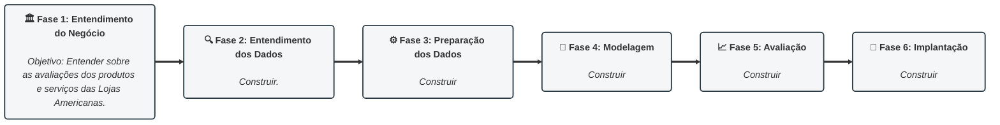

# mineracao_de_texto_POS_DATASCIENCE_SENAC
Repositório criado para atividade prática e desenvolvimento das aulas da disciplina da Pós Graduação em Ciência de Dados e Inteligência Artificial do SENAC DF

## Alunos
 
 
 
 

## 📌 Metodologia: CRISP-DM

Para este projeto vamos adotar o seu desenvolvimento seguindo as diretrizes da metodologia **CRISP-DM** (*Cross-Industry Standard Process for Data Mining*), dividida nas seguintes fases:

---

## 📌 DataSet 

Para este projeto vamos utilizar um dataset real com 132 mil avaliaçãoes de clientes da loja Americanas.com que pode ser acesso em "https://raw.githubusercontent.com/americanas-tech/b2w-reviews01/main/B2W-Reviews01.csv"
